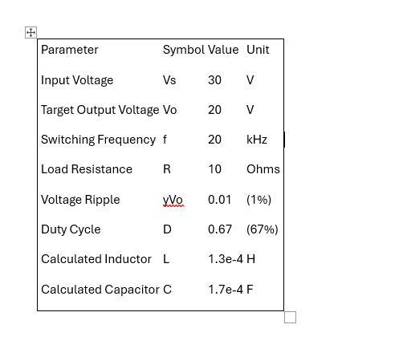
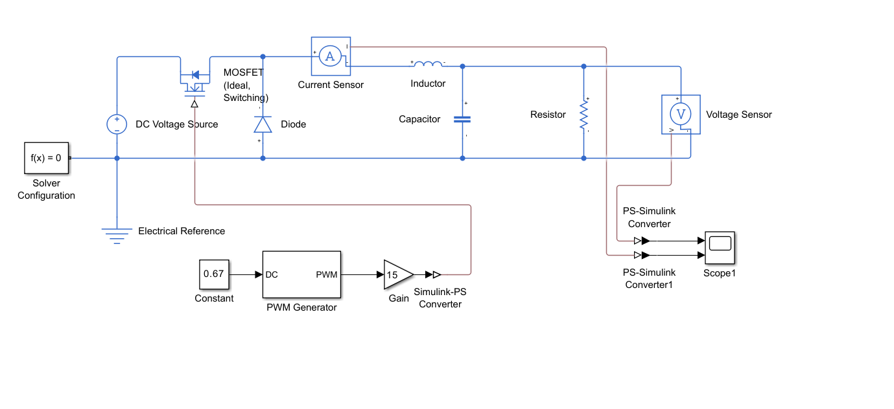
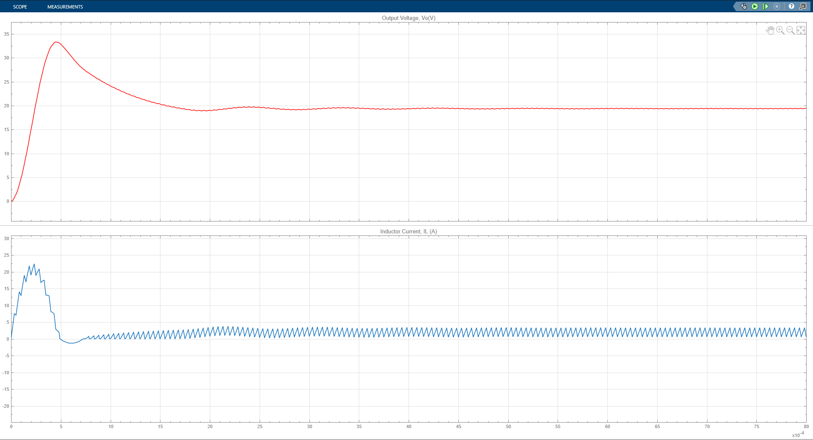

# DC-DC Buck Converter Design and Simulation

## Abstract
This repository contains the analytical design and Simulink simulation of a step-down DC-DC Buck Converter. The primary objective is to regulate a **30 V** DC input to a steady **20 V** output across a **10 Ω** resistive load. The simulation model is constructed utilizing standard Simscape Electrical blocks, providing a robust alternative methodology that circumvents the need for the legacy Specialized Power Systems library.

## Design Specifications
The component values are derived analytically to meet a target switching frequency of **20 kHz** and maintain a maximum voltage ripple of **1%**. The comprehensive calculations are documented in the provided spreadsheet.

**Design Parameters:**
*   **Input Voltage ($V_s$):** 30 V
*   **Output Voltage ($V_o$):** 20 V
*   **Switching Frequency ($f$):** 20 kHz
*   **Load Resistance ($R$):** 10 Ω
*   **Voltage Ripple ($yV_o$):** 0.01
*   **Duty Cycle ($D$):** 0.67
*   **Calculated Inductance ($L$):** 1.3e-4 H
*   **Calculated Capacitance ($C$):** 1.7e-4 F

## Simulation Architecture
The Simulink model (`DC_DC_buck.slx`) is partitioned into two principal subsystems: the control stage and the physical power stage.

1.  **Control Stage:** A Constant block outputs the 0.67 duty cycle, which is fed into a PWM Generator operating at 20 kHz. A Gain block scales the pulse amplitude, and a Simulink-PS Converter translates the mathematical signal into a physical electrical pulse to trigger the MOSFET gate.
2.  **Power Stage:** The physical circuit consists of the 30 V DC source, an ideal switching MOSFET, a freewheeling diode, an inductor, a smoothing capacitor, and the load resistor. Current and voltage sensors measure the system states, utilizing a PS-Simulink Converter to route the data to the Scope for observation.

## Results and Discussion
The simulation is executed with a discrete sample time of 1e-6 s. The resulting waveforms, as observed in the Scope, validate the analytical design.

*   **Output Voltage:** The system exhibits a transient overshoot during the initial startup phase. Following this, the voltage stabilizes at a steady-state value of exactly 20 V, maintaining the specified low ripple.
*   **Inductor Current:** The current stabilizes at an average value of 2 A (consistent with $V_o/R$). The waveform displays the characteristic triangular ripple inherent to continuous conduction mode (CCM) operation at 20 kHz.

## Repository Contents
*   `DC_DC_buck.slx`: The primary Simulink model file.
*   `Design Specifications.xlsx`: The analytical calculation spreadsheet.
*   `Design Specification.png`: Image of the calculated parameters.
*   `DC-DC_Buck.png`: Schematic capture of the Simulink model.
*   `Output Graph.png`: Screenshot of the simulation results from the Scope.

## Usage Instructions
1. Open MATLAB and navigate to the project directory.
2. Load the `DC_DC_buck.slx` model.
3. Ensure the calculated parameters ($D, L, C, f$) are defined in the MATLAB workspace.
4. Execute the simulation and open the Scope block to observe the voltage and current waveforms.